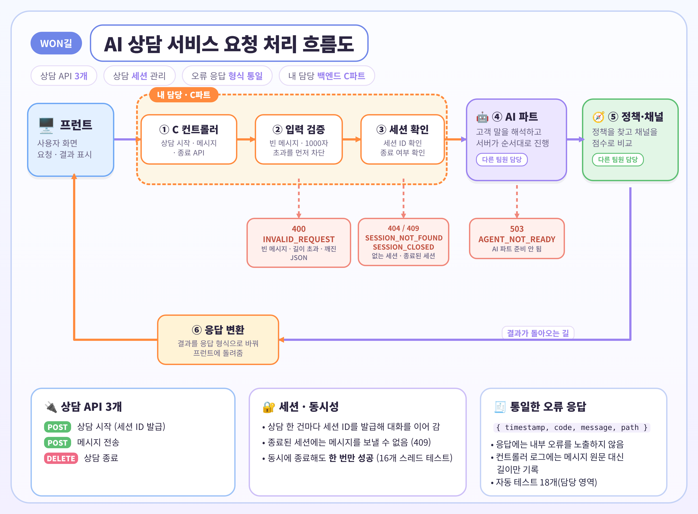

<table>
<tr>
<td width="130" valign="top"></td>
<td valign="top">
<h1>하창빈</h1>

백엔드 개발을 배우고 있는 신입 개발자입니다. 팀 프로젝트에서 서버 API를 직접 구현했고, AI 도구가 짠 코드의 요청 흐름을 따라가며 이해하고 확인하는 과정에서 가장 많이 배웠습니다.

<ul>
<li><b>이메일</b> bindow99@naver.com</li>
<li><b>GitHub</b> <a href="https://github.com/Bin-dow">github.com/Bin-dow</a></li>
<li><b>학력</b> 강원대학교 컴퓨터학부 컴퓨터과학전공 (2024.02 졸업)</li>
<li><b>교육</b> 우리WON 청년 IT 아카데미 (2026.08 ~ 2026.12)</li>
</ul>
</td>
</tr>
</table>

---

## 대표 프로젝트: WON길

**우리은행 고객이 상담 채널을 헤매지 않도록, AI가 알맞은 채널을 추천하는 서비스를 만든 팀 프로젝트입니다. 저는 백엔드에서 상담 API, 세션, 예외 처리를 맡았습니다.**

| 항목 | 내용 |
| --- | --- |
| 행사 | 우리WON 청년 IT 아카데미 AX 해커톤 (주제: 일상 속 금융 불편함을 AI로 해결하라) |
| 기간 | 2026.10.26 ~ 10.28 (3일) |
| 팀 | B반 1팀, 5명 |
| 결과 | 우수상 (개발 부문) |
| 상태 | 해커톤 종료. 남은 과제 1건(모델 장애 503 매핑) |
| 내 담당 | 백엔드 C파트 (상담 API, 세션, 예외 처리) |
| 프로젝트 기술 | Java 21, Spring Boot 4.1.2, Spring AI, MySQL, Gradle |
| 제가 사용한 기술 | Java, Spring Boot, JUnit, Mockito, Git·GitHub |

### 어떤 문제를 다뤘나

고객이 자기 상황에 맞는 상담 채널(챗봇·전화·이메일)을 스스로 고르기 어렵다는 문제를 다뤘습니다. 단기간 프로젝트여서 문제 조사보다 구현에 집중했고, 이 문서에서는 제가 맡은 구현 위주로 적습니다. AI가 고객의 문장에서 조건을 읽고, 서버가 챗봇·전화·이메일을 점수로 비교해 순위와 이유를 알려 주는 방식으로 이 문제를 다뤘습니다.

### 팀이 만든 것과 제가 맡은 부분

5명이 영역을 A(AI 에이전트), B(채널 정책), C(API·세션)로 나눠 진행했습니다.

| 파트 | 담당 | 하는 일 |
| --- | --- | --- |
| A · AI 에이전트 | 팀원 | 고객 문장에서 업무 종류와 조건을 해석하고, 서버가 정한 순서로 진행 |
| B · 정책·채널 평가 | 팀원 | 조건에 맞는 정책을 찾고, 챗봇·전화·이메일을 점수로 비교해 순위와 이유를 반환 |
| **C · API·세션** | **저** | 요청이 들어오는 입구를 만들어 AI 파트로 전달하고, 결과를 응답 형식으로 바꿔 돌려줌 |

A·B의 세부 구현(프롬프트, 배점 근거, 정책 데이터 출처)은 제가 확인하지 못해 적지 않았습니다.

### 요청 처리 흐름

프런트의 요청이 제 담당 구간(컨트롤러 → 입력 검증 → 세션 확인)을 지나 AI 파트로 전달되고, 결과를 응답 형식으로 바꿔 돌려주는 흐름입니다. 주황색 구간이 제가 맡은 부분입니다.

### 제가 구현한 것

- **상담 API 3개**: 상담 시작(POST), 메시지 전송(POST), 상담 종료(DELETE)
- **상담 세션 관리**: 상담 한 건마다 세션 ID를 발급해 대화를 이어 가고, 종료된 세션에는 메시지를 보낼 수 없게 처리
- **동시 종료 처리**: 종료 요청이 동시에 들어와도 한 번만 성공하도록 ConcurrentHashMap의 원자적 `replace`로 구현
- **입력 검증**: 빈 메시지와 1000자 초과 요청은 요청 검증 단계에서 400으로 거절
- **예외 처리 통일**: 오류 응답을 `{ timestamp, code, message, path }` 형식으로 통일하고, 응답에는 내부 오류를 노출하지 않음. 컨트롤러 로그에는 메시지 원문 대신 길이만 기록
- **CORS**: 프런트 개발 서버(`localhost:5173`, `127.0.0.1:5173`)에서 `/api/**` 호출을 허용
- **달라진 점**: 종료된 세션에는 메시지를 보낼 수 없어 끝난 상담이 이어지지 않고, 잘못된 입력은 AI 파트까지 전달되지 않습니다.

| 상태 | code | 상황 |
| --- | --- | --- |
| 400 | INVALID_REQUEST, INVALID_SESSION_ID | 빈 메시지·1000자 초과·깨진 JSON, 형식이 잘못된 세션 ID |
| 404 | SESSION_NOT_FOUND | 없는 세션 |
| 409 | SESSION_CLOSED | 이미 종료된 세션 |
| 503 | AGENT_NOT_READY | AI 파트가 연결되지 않음 |
| 500 | INTERNAL_ERROR | 예상하지 못한 오류 |

### 확인한 근거

- 담당 영역의 테스트 18개를 작성했고(이후 PR #4에서 팀원이 일부 수정), 10/27 기준 통과를 확인했습니다. 수명주기, 세션 격리, 종료 후 409, 입력 오류, CORS를 다루고, 16개 스레드로 동시에 종료해도 한 번만 성공하는 테스트가 포함됩니다.
- 제 PR: [PR #1](https://github.com/won-way/backend/pull/1)
- 구현 커밋: `d65220c` 상담 API·세션 수명주기(10/27 15:28), `012567c` CORS 허용(10/27 16:09)
- 저장소: [github.com/won-way/backend](https://github.com/won-way/backend)

근거 위치 (파일은 모두 `src/main/java/com/example/wonway/`, 테스트는 `src/test/java/com/example/wonway/` 아래):

| 구현 | 코드 | 확인한 테스트 |
| --- | --- | --- |
| 동시 종료·세션 관리 | `session/InMemoryConsultationSessionService.java` (`closeSession`) | `InMemoryConsultationSessionServiceTest` · `동시에_종료를_요청해도_한_번만_성공한다` |
| 입력 검증 | `api/dto/request/ConsultationMessageRequest.java` | `ConsultationControllerTest` · `잘못된_입력은_400이고_에이전트를_호출하지_않는다` |
| 오류 응답 통일 | `api/GlobalExceptionHandler.java` | `ConsultationControllerTest` · `종료_후_메시지는_409이고_에이전트를_호출하지_않는다`, `존재하지_않는_세션은_404` |
| AI 파트 없을 때 503 | `api/ConsultationController.java` (`ObjectProvider<AgentService>`) | `ConsultationControllerWithoutAgentTest` |
| CORS | `api/config/CorsConfig.java` | `CorsConfigTest` |

### 트러블슈팅: AI 파트가 없는 상태에서 C파트를 따로 확인하기

- **문제**: AI 파트(A) 구현이 끝나기 전에는 C파트를 실제 흐름으로 끝까지 확인할 수 없었습니다.
- **대응**: 컨트롤러·CORS 테스트에서 AgentService를 Mockito로 대체해 AI 파트 없이 상담 API의 응답 형식, 세션 종료, 오류 응답을 검증했습니다. AgentService 구현체가 없어도 서버는 기동되고 메시지 API만 503 AGENT_NOT_READY를 반환하도록 구성했고, 이 동작도 별도 테스트로 확인했습니다.
- **한계**: 테스트 코드는 AI 도구의 도움을 받아 작성했고, 시간 부족으로 모든 케이스를 직접 검증하지는 못했습니다.

### AI 활용과 제가 검증한 부분

- AI 도구로 작성한 코드는 요청 흐름을 따라가며 이해한 뒤 이상한 부분을 확인했습니다. 다만 모든 코드를 검증하지는 못했고, 문제가 되는 부분 위주로 확인했습니다.
- 제 커밋에는 AI 도구와의 공동 작성(Co-Authored-By)이 표기돼 있습니다.

### 배운 점과 남은 과제

- 기획 단계에서 기능 범위와 역할을 팀원마다 다르게 해석해 조율에 시간이 들었습니다. 이를 문서로 더 구체적으로 맞췄다면 개발 시간을 더 확보할 수 있었을 것입니다.
- AI 도구가 짠 코드도 요청 흐름을 이해하고 확인해야 쓸 수 있다는 것을 배웠습니다.
- 협업할 때는 담당 폴더를 나눠 제 영역(`api`, `session`)만 수정하고, 작업 브랜치에서 PR로 제출했습니다. API 키가 들어가는 `.env` 파일은 커밋하지 않았습니다.
- 이후 PR #4에서 팀원이 응답 필드 확장, 응답 완료 로그, 종료 시 대화 메모리 삭제 연동을 구현했습니다(메모리 삭제는 제가 TODO로 남겨 둔 부분). 그래서 최종 응답은 제 초기 버전과 다릅니다.
- 다음 개선 행동: AI 파트가 장애 예외 타입을 정하면, 모델 장애(타임아웃·빈 응답 등)를 503으로 매핑합니다. 장애를 일으키는 테스트가 503을 돌려주면 완료로 봅니다. 현재는 500으로 처리되며 코드에 TODO로 남겨 두었습니다.

---

## 기술 사용 경험

| 기술 | 어디에 사용했나 |
| --- | --- |
| Java, Spring Boot | WON길 C파트 API·세션 구현 |
| MySQL | WON길 프로젝트의 정책 데이터 저장소(팀원 담당 부분). 제 담당 코드(`api`, `session`)는 DB를 직접 다루지 않음 |
| JUnit, Mockito | WON길 C파트 테스트 (Mockito는 컨트롤러·CORS 테스트) |
| Gradle | WON길 프로젝트 빌드 |
| Git, GitHub | 작업 브랜치와 PR 기반 협업 |

## 자격

- 정보처리기사 (2023.06), SQLD (2024.09), ADsP (2026.06), 리눅스마스터 2급 1차 합격 (2026.11)
